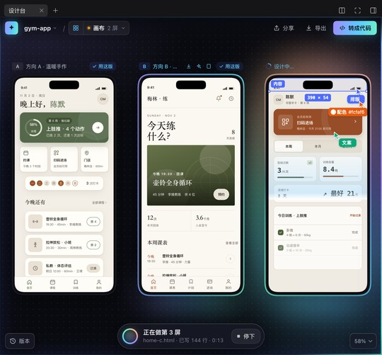
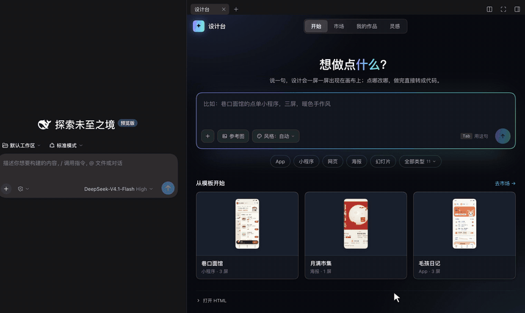

  
  
  

  <a href="README.md">简体中文</a> ·
  <a href="README.en.md"><b>English</b></a>

**Design Studio** is a DeepSeek Harness (DSH) plugin. Say what you want to make, and the model's web pages, app screens, mini programs, desktop apps, posters, slides, mind maps and roadmaps appear one by one on a canvas in the right sidebar, inside phone, browser or app-window device frames. Click the direction you like, or click whatever looks off and add a sentence, and the model edits it.

## Install

1. In DSH, open **Plugins** → **Add plugin**, enter the package name `dsh-design-studio`, and install.
2. **Then click Enable now.** Plugins start disabled and do nothing until you enable them.
3. Start a new session and pick **Design mode**. No restart needed.

**Requirements:** works in the DSH desktop app and the web version, on Mac and Windows. The design check needs Chrome or Edge on your computer.

If DSH can't reach the npm registry, it falls back to a mirror in China. To update on DSH 0.2.2 or later, open it on the Plugins page and click "Update to …"; on older DSH, uninstall it and add it again. A new version installs by package name about a day after release; to get it right away, uninstall it and enter the release tarball `https://github.com/OrderG-X/dsh-design-studio/releases/latest/download/dsh-design-studio.tgz` (needs GitHub access) — a tarball install can't use Update later.

## Quick start

1. In Design mode, say what to make, for example "Design a member app for a neighborhood gym". You can also type it in the big box on the studio's home page: pick a type and a style and press ↑ (Tab fills in an example when the box is empty).
2. The model asks two or three questions, then lays out three directions side by side. Click **✓ Use this take** next to the title of the one you like and send it; the model builds the rest.
3. To change something, click **Select** on the island at the bottom (or press V), then the element, type "bigger" or "make it red", and send.

## What it does

- **The 1.0 interface:** a title bar on top (Page setup, screens, Share, Export, Build as code) and an island at the bottom (Ask or run a command, Select, Text, Style, Annotate, Present, Theme, Check). One panel at a time: a drawer on a narrow sidebar, a card on the right with DSH full screen. ⇧⌘K (Ctrl+Shift+K on Windows) opens the command palette, V T S P R L C switch tools, and the motion is a soft aurora.
- **Pick from three directions:** three different first screens side by side, then the full set in the one you pick. Any single screen can also get two alternative takes.
- **Click to edit:** click an element or drag over an area, and a small chip lands in the input (hover it for details); just add how to change it. Annotations, style changes, style cards and check lists land as chips too, not walls of text. The model still gets the full location and styles. Changed spots flash in the preview. You can also draw circles, arrows and notes right on the page and hand the marked-up screenshot to the model, or copy it to paste elsewhere. Adjust style can apply a change to every screen at once, and when you edit a design by hand in the sidebar, the model is told before its next step so it won't undo your edits.
- **Open what you have:** home ＋ › Open HTML… picks an HTML file, or drop an HTML file or folder onto the sidebar (desktop app); you can also type a path or a dev-server port.
- **Design check:** one click finds overflowing text, low contrast, small tap targets and tiny text, marked right on the page. In Design mode the model also checks its own work and fixes what it finds.
- **Clickable prototypes:** back arrows marked `data-back` go back to wherever you came from; the different looks of one page (empty list, with data, paid) are states in one file instead of extra screens, switchable next to the screen name on the canvas, and checked and exported state by state. The design check also points out a shared part that is styled differently on different screens (#30).
- **Mock data:** ask for a prototype whose clicks really change things and survive page changes, and the model writes `mock.json` as the data source and binds the pages to it: "Accept offer" switches the whole app to its on-site stage, clocking in updates the time, and it all stays across pages and reloads; a global stage or role changes every page at once. **Data** in the bottom bar opens the data as a tree: edit any value, reset it, or save it as the initial data. The HTML demo carries the data too, with a Reset data button (#30).
- **Versions and compare:** every turn is saved; drag a slider to compare, and go back to any version.
- **Export and share:** Export makes showcase images, PDF and PowerPoint (links between screens still work), and designs with hundreds of screens export in full (up to 1000). Share has a clickable HTML demo that opens with a double-click (device frame included, ready to send to a client), a temporary online link (beta; opens in WeChat or any browser, closes after 2 hours), and Phone preview, a QR code to see it on your phone at real size. Slides and posters larger than the default size now use the page's real size. You can also set it by adding `WIDTHxHEIGHT` after the type, for example `<meta name="dsh-design" content="slides 1440x810">`. Export options let you pick the page size (16:9, 4:3, A3 landscape or custom), the capture (current viewport, full-length page or a set height) and two screens per page. If anything would be cut off, you get a checklist first, with a one-click fix that fits the size to the content.
- **Diagrams:** mind maps, technical route charts (the kind in grant proposals and theses), product roadmaps and system architecture diagrams. Roadmaps & diagrams sits right on the home page type row; pick it and a second row offers Technical roadmap (grant proposal), Research framework, Architecture, Mind map and Product roadmap, each with its own example. Lines, branches and arrows are laid out for you and re-flow when you change text or add nodes; colors follow the design style, and a high-resolution PNG or PDF export drops straight into Word or PowerPoint. For grant-proposal and final-report frameworks, the model first lists how the parts relate (which problem maps to which task) for you to confirm, then draws labelled arrows between the blocks, in a bold 3D-gradient "proposal" style by default or after a reference image you give it.
- **DSH plugins:** design a plugin inside the real DSH desktop frame (left sidebar entry, settings section, session tab or right sidebar panel, in light and dark). Only the plugin area is designed, so you see exactly how it looks once installed; the design check warns if the frame gets changed.
- **Gallery, My designs, Inspiration:** three tabs on the home page. My designs has everything you've designed (and your saved frames, which you can rename or delete); Inspiration holds saved references and styles; the Gallery has templates, design systems and style cards others shared, and "Start from this" copies one for you to keep editing. Submit your own with Share › Submit to gallery: it's checked, zipped and submitted, and listed once reviewed. The gallery catalog comes from npm mirrors and is used only when its signature and checksums match; to keep it offline, turn on "Design library offline" on the Plugins page.
- **Your brand, and real code:** give a site URL to extract a brand design system and design with it from then on; turn a finished design into React / Vue / HTML (mini programs straight into uni-app or native WeChat code, HBuilderX projects included), compared screen by screen against the design.
- **Built-in photo library:** for designs that rely on photos (hotels, food, cafes, fitness, beauty, fashion, education, travel), the model uses real-looking photos instead of only drawing illustrations. About 8 MB is downloaded the first time it is needed. All of them are AI-generated placeholders, so replace them with real photos before launch.
- **Built-in font library:** click a font row in the Theme panel to pick from 18 free, commercially usable fonts (Noto Sans / Serif SC, Smiley Sans, the ZCOOL family, brush and running-script calligraphy, plus Latin faces such as Inter). The page updates at once; saving copies the font files into the design folder, so exports and remote viewing keep them. You can also just ask the model, e.g. "use brush calligraphy for the headline". About 19 MB is downloaded the first time it is needed.
- **Real components:** parts repeated across screens (tab bars, top bars, cards) live as components in `components/`, and each screen uses them as `<c-name>`. Change one component and every screen using it follows; exports are still plain HTML that opens offline. The model pulls out components on its own when it builds several screens, and can convert an existing design too; a broken component shows as a red box in the preview, and the check says exactly where.
- **A style that fits the subject:** when you have not chosen a style, the model first picks a style card for the subject (colors, fonts, corner radius) and builds with it, so a homestay app, a bubble-tea shop and a review deck no longer all come out beige. If you name a style or colors, it follows yours.
- **Business annotations (experimental, off by default):** turn on "Business annotations" under Design Studio on the Plugins page, and the model also writes `annotations.json` with the rules, states and edge cases the UI does not show. Numbered markers appear on the page and cards in the sidebar, and clicking either one finds the other. Code handoff passes the rules on to developers (#15).

See [all features](https://github.com/OrderG-X/dsh-design-studio/blob/main/docs/features.md) for every feature, the tool parameters and the security design, and [development](https://github.com/OrderG-X/dsh-design-studio/blob/main/docs/development.md) for dev setup and tests.

## Feedback

Found a bug or want a feature? [Open an issue](https://github.com/OrderG-X/dsh-design-studio/issues/new/choose). Include your DSH and plugin versions so it can be fixed quickly.

## License

MIT
