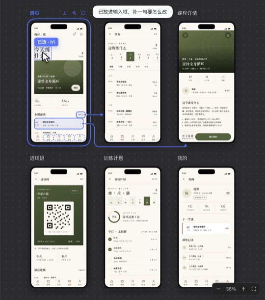
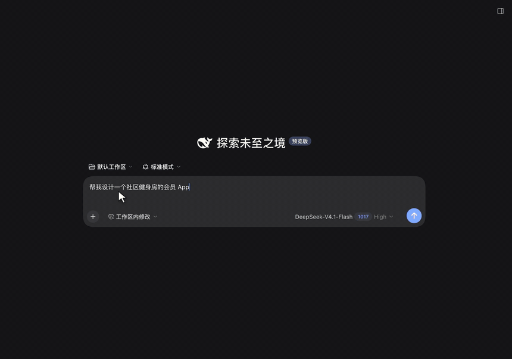

  
  
  

  <a href="README.md">简体中文</a> ·
  <a href="README.en.md"><b>English</b></a>

**Design Studio** is a DeepSeek Harness (DSH) plugin. Say what you want to make, and the model's web pages, app screens, mini programs, desktop apps, posters and slides appear one by one on a canvas in the right sidebar, inside phone, browser or app-window frames. Click the direction you like, or click whatever looks off and add a sentence, and the model edits it.

## Install

1. In DSH, open **Plugins** → **Add plugin**, enter the package name `dsh-design-studio`, and install.
2. **Then click Enable now.** Plugins start disabled and do nothing until you enable them.
3. Start a new session and pick **Design mode**. No restart needed.

**Requirements:** works in the DSH desktop app and the web version, on Mac and Windows. The design check needs Chrome or Edge on your computer.

If DSH can't reach the npm registry, it falls back to a mirror in China. To update on DSH 0.2.2 or later, open it on the Plugins page and click "Update to …"; on older DSH, uninstall it and add it again. A new version installs by package name about a day after release; to get it right away, uninstall it and enter the release tarball `https://github.com/OrderG-X/dsh-design-studio/releases/latest/download/dsh-design-studio.tgz` (needs GitHub access) — a tarball install can't use Update later.

## Quick start

1. In Design mode, say what to make, for example "Design a member app for a neighborhood gym". The empty sidebar also has a few example prompts you can click into the input.
2. The model asks two or three questions, then lays out three directions side by side. Click **✓ Use this** next to the title of the one you like and send it; the model builds the rest.
3. To change something, click **Select** in the toolbar, then the element, type "bigger" or "make it red", and send.

## What it does

- **Pick from three directions:** three different first screens side by side, then the full set in the one you pick. Any single screen can also get two alternative takes.
- **Click to edit:** click an element or drag over an area, and a small chip lands in the input (hover it for details); just add how to change it. Markup, style changes, style cards and check lists land as chips too, not walls of text. The model still gets the full location and styles. Changed spots flash in the preview. You can also draw circles, arrows and notes right on the page and hand the marked-up screenshot to the model, or copy it to paste elsewhere.
- **Open what you have:** click "Browse…" on the empty page to pick an HTML file, or drop an HTML file or folder onto the sidebar (desktop app); you can also type a path or a dev-server port.
- **Design check:** one click finds overflowing text, low contrast, small tap targets and tiny text, marked right on the page. In Design mode the model also checks its own work and fixes what it finds.
- **Versions and compare:** every turn is saved; drag a slider to compare, and go back to any version.
- **Export and phone preview:** showcase images, PDF and PowerPoint (links between screens still work); scan a QR code to see it on your phone at real size. Slides and posters larger than the default canvas now use the page's real size. You can also set it by adding `WIDTHxHEIGHT` after the type, for example `<meta name="dsh-design" content="slides 1440x810">`. Export options let you pick the page size (16:9, 4:3, A3 landscape or custom), what each page shows (one screen, full page or a set height) and two screens per page. If anything would be cut off, you get a checklist first, with a one-click fix that fits the canvas to the content.
- **Design library and gallery:** everything you've designed, plus saved references and styles, lives in the Library. Browse templates, design systems and style cards others shared, and "Start from this" copies one for you to keep editing. Share your own with "Share to the gallery": it's checked, zipped and submitted on a web page, and listed once reviewed. The gallery catalog comes from npm mirrors and is used only when its signature and checksums match; to keep it offline, turn on "Design library offline" on the Plugins page.
- **Your brand, and real code:** give a site URL to extract a brand design system and design with it from then on; turn a finished design into React / Vue / HTML (mini programs straight into uni-app or native WeChat code, HBuilderX projects included), compared screen by screen against the design.
- **Built-in photo library:** for designs that rely on photos (hotels, food, cafes, fitness, beauty, fashion, education, travel), the model uses real-looking photos instead of only drawing illustrations. About 8 MB is downloaded the first time it is needed. All of them are AI-generated placeholders, so replace them with real photos before launch.
- **A style that fits the subject:** when you have not chosen a style, the model first picks a style card for the subject (colors, fonts, corner radius) and builds with it, so a homestay app, a bubble-tea shop and a review deck no longer all come out beige. If you name a style or colors, it follows yours.
- **Business annotations (experimental, off by default):** turn on "Business annotations" under Design Studio on the Plugins page, and the model also writes `annotations.json` with the rules, states and edge cases the UI does not show. Numbered markers appear on the page and cards in the sidebar, and clicking either one finds the other. Code handoff passes the rules on to developers (#15).

See [all features](https://github.com/OrderG-X/dsh-design-studio/blob/main/docs/features.md) for every feature, the tool parameters and the security design, and [development](https://github.com/OrderG-X/dsh-design-studio/blob/main/docs/development.md) for dev setup and tests.

## Feedback

Found a bug or want a feature? [Open an issue](https://github.com/OrderG-X/dsh-design-studio/issues/new/choose). Include your DSH and plugin versions so it can be fixed quickly.

## License

MIT
