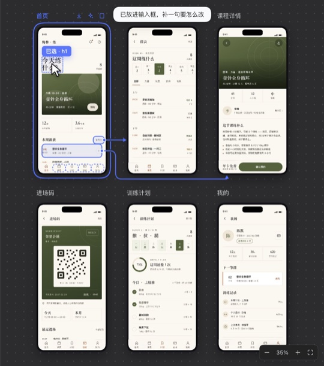
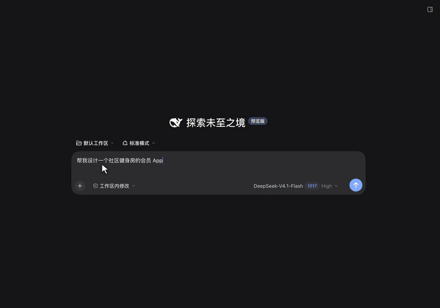

  
  
  

  <a href="README.md"><b>简体中文</b></a> ·
  <a href="README.en.md">English</a>

**设计工作台**是 DeepSeek Harness（DSH）的插件：说一句要做什么，模型做的网页、App 界面、小程序、桌面软件、海报、幻灯片在右边画布上一屏屏长出来，套着手机、浏览器或软件窗口外框。看中哪个方向点一下，哪里不对点一下说一句，模型就照着改。

## 安装

1. DSH 左边「插件」→「添加插件」，填包名 `dsh-design-studio`，点安装。
2. **装好后点「立即启用」**。插件默认是关的，不点不生效。
3. 新建会话，模式选「设计模式」。不用重启 DSH。

**需要什么**：DSH 桌面版、网页版都能用，Mac、Windows 都行。「设计体检」要电脑上装着 Chrome 或 Edge。

连不上 npm 时 DSH 会自动换国内镜像。更新：DSH 0.2.2 起，在「插件」页点开它，点「更新到 …」；更老的 DSH 先卸载，再添加一次。新版发布后大约一天，按包名才装得到；急的话卸载后填发布包地址 `https://github.com/OrderG-X/dsh-design-studio/releases/latest/download/dsh-design-studio.tgz`（要能连上 GitHub），不过这样装的以后不能点更新。

## 三步上手

1. 在设计模式里说一句要做什么，比如「帮我设计一个社区健身房的会员 App」。也可以直接在设计台首页的大输入框里说：挑个类型、风格，点 ↑ 就发出去（没写字时按 Tab 用例子）。
2. 模型先问两三个问题，再出三个方向并排在画布上。看中哪个，点它标题旁的「✓ 就要这个」，发出去，模型接着做全套。
3. 哪里不对，点工具栏「选择」，再点那个元素，接着说「字大一点」「换成红色」，发出去。

## 能做什么

- **三个方向挑着做**：先出三个风格不同的首屏并排比，挑中再做全套；单独一屏也能「再出两版」。
- **点一下就改**：点元素或框一块区域，输入框里出现一个小标签（悬停看详情），你只要补一句怎么改；标注、调样式、风格、体检清单这些放进输入框的也都是小标签，不再是一大段字；发出去模型拿到完整的位置和样式。改过的地方在预览里闪一下。也能直接在页面上画圈、画箭头、写字，拼成一张图交给模型，或者复制下来贴到别处。
- **打开已有的页面**：首页输入框左边的「+」→「打开已有的 HTML…」选一个，或把 HTML 文件 / 文件夹拖进右侧栏就能预览（桌面版）；也能输路径或开发服务器端口。
- **设计体检**：一键查文字溢出、对比度不够、按钮太小、字太小，问题直接标在页面上；模型做完也会自己查一遍再改。
- **版本和对比**：每轮自动存一版，左右拖动对比，随时回到任意一版。
- **导出和手机上看**：导出展示图、PDF、PPT（屏和屏之间的跳转照样能点）；扫码在手机上按真机尺寸看。页面比默认画幅大的幻灯片、海报，画幅自动跟页面走；也可以在类型后面跟 `宽x高` 指定，比如 `<meta name="dsh-design" content="slides 1440x810">`。导出选项里可以选版面（16:9、4:3、A3 横向、自定义）、每页取景（一屏、整页、指定高度）和每页拼 2 屏；有内容会被裁时，导出前先给一张清单，可以一键按内容改画幅。
- **设计库和设计市场**：以前做过的设计、收的参考图和风格都在「设计库」里；市场里逛大家分享的模板、设计系统和风格卡，点「用这个开始」复制一份接着改。自己做的点「分享到设计市场」，查过打成 zip，在网页里交上去，审过就上架。市场目录从 npm 镜像取，签了名、核对过才用；不想让它联网，在插件页打开「设计库不联网」。
- **照品牌风格做、转成代码**：给官网地址，提一套品牌设计系统，以后都照它做；做好的设计转成 React / Vue / HTML，小程序直接转成 uni-app 或原生小程序代码（HBuilderX 建的项目也认得出），逐屏和设计稿比对。
- **自带照片库**：民宿酒店、餐饮、奶茶咖啡、健身、美妆、服饰、教育、旅行风景这些靠照片说话的设计，模型会直接用上照片，不再只画插画。第一次用到时下载约 8 MB。都是 AI 生成的示意图，上线前请换成真实照片。
- **按题材挑风格**：没定风格时，模型先按题材挑一张风格卡（配色、字体、圆角）再动手，民宿、奶茶店、复盘幻灯片不再都是一个米色调；你自己说了风格或配色就照你的。
- **业务标注（试验，默认关）**：在「插件」页的设计工作台里打开「业务标注」，模型做设计时同时写一份 `annotations.json`，记界面上看不出来的规则、状态和边界。页面上出编号，右侧栏列卡片，点哪边都能定位到另一边；转成代码时这些规则一起交给开发（#15）。

全部功能、工具参数和安全设计见[完整功能](https://github.com/OrderG-X/dsh-design-studio/blob/main/docs/功能详解.md)；开发和测试见[开发说明](https://github.com/OrderG-X/dsh-design-studio/blob/main/docs/开发.md)。

## 反馈

遇到问题或想要新功能，[提一个 issue](https://github.com/OrderG-X/dsh-design-studio/issues/new/choose)。报问题时写上 DSH 版本和插件版本，修起来最快。

## License

MIT
