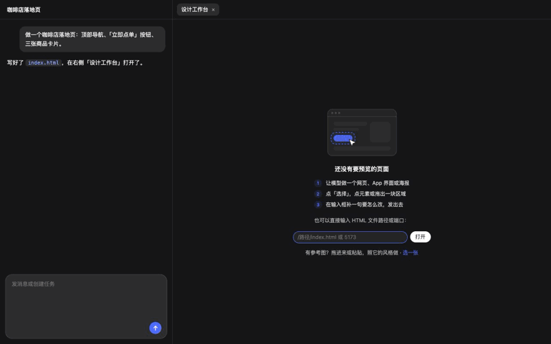
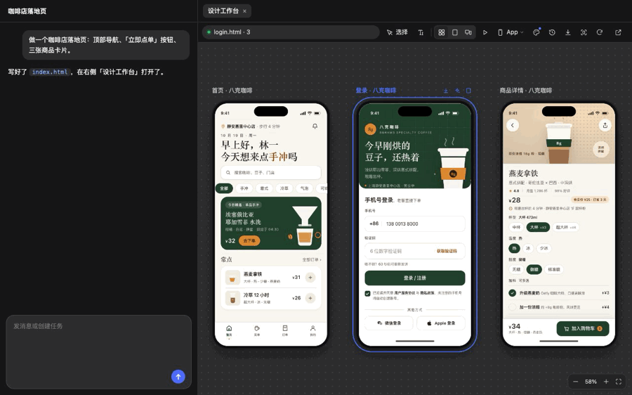
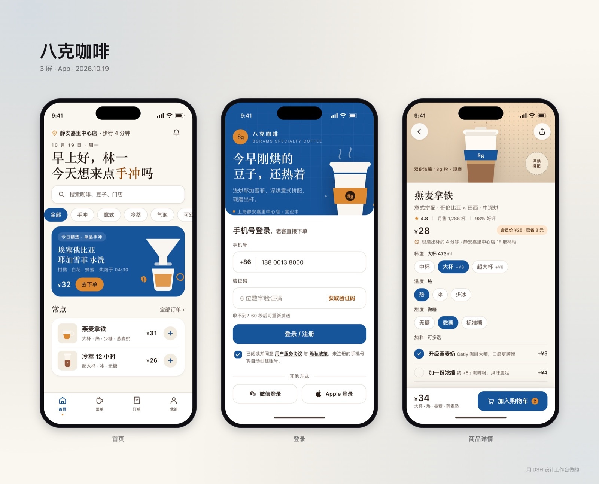

<div align="center">



<p>
  <a href="https://github.com/OrderG-X/dsh-design-studio/releases"></a>
  
  <a href="https://github.com/awesome-dsh-plugin/awesome-dsh-plugin"></a>
</p>

<p>
  <a href="README.md"><b>简体中文</b></a> ·
  <a href="README.en.md">English</a>
</p>

</div>

让 DSH（DeepSeek Harness）做界面设计时像 Google Stitch / Claude Code 桌面端那样：模型做网页、App 界面、海报、幻灯片时，右侧栏「设计工作台」实时显示——一屏一屏生成出来，在画布上并排摆好，套上手机 / 浏览器外框；看到哪里不对，点一下那个元素、或拖出一块区域，它就整理成一段文字放进输入框，补一句「改成橙色」发出去，模型照着源码改，改过的地方在预览里闪一下。



改一句「主色换成深海蓝」→ 三屏一起变；翻到上一版、左右拖动对比；一键导出整套展示图：



导出的展示图（插件直接生成，没有再加工）：



## 安装

```sh
dsh plugin add https://github.com/OrderG-X/dsh-design-studio/releases/latest/download/dsh-design-studio.tgz
```

装完**重启 DSH**（客户端代码在 DSH 启动时打包）。DSH「插件」页里显示为「设计工作台」。

开发时可以直接链到本地目录：`dsh plugin --profile desktop add link:/path/to/dsh-design-studio`，改了客户端代码同样要重启（`lib/picker.js` 每次现给，不用重启）。

## 用起来是什么样

1. **做设计时自动打开**：模型加载了设计技能、调了 `preview_page`，或页面写了设计类型标记（`<meta name="dsh-design">`）之后，再写 `.html` 文件或用命令起开发服务器（`npm run dev` 这类），右侧栏自动弹出「设计工作台」。别的任务写的网页不弹，只在标题栏按钮上亮个蓝点，点开能一键预览；`curl`、浏览器工具去看别的端口，一律不当成要预览的页面。
2. **分类型显示**：网页（浏览器窗口）、App（手机外框带灵动岛）、平板、海报（1080×1350）、幻灯片（16:9）、邮件。模型调工具时说明类型，或在页面里写 `<meta name="dsh-design" content="app">`（可带尺寸，如 `poster 1080x1920`）；工具栏「类型」菜单随时能换。
3. **多屏画布**：同一个目录里的几个 HTML 文件按生成顺序排成网格，能拖、能缩放（触控板双指滑 = 平移，捏合 / ⌘ 滚轮 = 缩放，右下角适合画布）。点一下选中一屏，双击只看这一屏；工具栏「画布 / 单页」切换。开发服务器可以让模型给几个路由并排看。
4. **看着它生成**：模型干活时右侧先放一个占位；新的一屏写出来，元素从上到下依次浮现，一道扫描光带过去；这一轮里还在出新屏时，画布末尾留一个「生成中…」的占位。
5. **实时刷新，不白屏**：本地 HTML 所在目录里任何文件一改，后台先载好新的一帧，再淡入换上来（滚动位置不丢）；开发服务器走它自己的热更新（Vite / Next 等的 WebSocket 照常通）。
6. **改了哪里一眼看到**：刷新 / 热更新前后各记一份页面「指纹」，改过、新加的元素在预览里亮一下（带一道扫光），都不在屏幕里就先滚过去；底下报「已更新 index.html · 1 处改动」。改的是共用的 CSS，画布上每一屏都会换帧、各自闪改动；只改某一屏的 HTML，别的屏不动。
7. **模型在干活时**：预览四周一圈流光，底下标「模型正在工作」或「正在写 style.css」。
8. **选择**：点工具栏「选择」，鼠标移到哪个元素就框哪个（带标签和尺寸，画布缩小时标签照样看得清；画布里点哪一屏都行）：
   - 点一下：选这个元素
   - 拖一块：选区域，里面的主要元素一起带上（最多 10 个）
   - Esc：取消
9. **进输入框**：选好的内容整理成一段文字插进输入框（插不进时复制到剪贴板），选中的地方留一个虚线框，例如：

   ```
   〔选中元素〕a.btn-order「立即点单 →」
   文件：/Users/me/site/index.html
   位置：section.hero > div.actions > a.btn-order
   HTML：<a class="btn-order" href="#menu">立即点单 →</a>
   样式：165×56 · color: rgb(255, 255, 255) · padding: 16px 36px · border-radius: 999px
   ```

   React / Vue / Svelte 的开发模式下还会带上组件名和源码位置。
10. **内置设计规范**：插件带一个 DSH 技能 `ui-design`，模型做界面前会加载：先定类型和画幅、先写 `tokens.css`（设计变量）、一屏一个文件；排版 / 间距 / 字号阶梯 / 配色 / 对比度 / 中文排版的规则，避开「AI 味」的清单，写完的自查表；网页、App、海报、幻灯片、邮件各有细则。在输入框打 `/ui-design` 也能手动加载。
11. **设计规范面板**：工具栏调色板按钮，列出这套设计 `:root` 上的设计变量，按颜色、字体、字号、间距、圆角、阴影分组，带色块和样例。点一个放进输入框（`〔设计变量〕--brand: #c26a32` 加文件位置），补一句「换成墨绿」，模型改这一个变量，所有屏一起变。还没有变量时，一键让模型按规范建一份。
12. **导出图片**：工具栏下载按钮，或画布上选中一屏后标签旁的按钮。可以导出这一屏（带手机 / 浏览器外框，或纯画面）、整页长图，以及几屏合成的一张展示图（品牌名做大标题、背景和主色取自设计变量，适合直接发朋友圈 / 小红书 / 作品集）。图片存到设计目录的 `exports/`，同时复制到剪贴板，点「打开文件夹」直接定位。
13. **版本**：每轮对话开始前、结束后各自动存一版（只存设计文件，名字就是你那句话，例如「主色换成深海蓝」；点选元素发出去的，名字是「「3.2 km」 · 改成绿色」这样，不会是一长串选择器）。工具栏时钟按钮列出所有版本；点一版就看当时的样子（画布 / 单页都行），点「对比」左右拖动把手，比较那一版和现在；「回到这一版」把文件写回去（回之前先把现在的存一版，随时能再切回来）。
14. **深色模式**：页面写了深色样式（`@media (prefers-color-scheme: dark)`，或 `[data-theme="dark"]` / `.dark`），工具栏多一个月亮按钮，一键切换看深色版，导出的图片也是深色的。
15. **再出两版**：画布上选中一屏，点标签旁的闪光按钮，让模型给这一屏出两版不同方向的设计（`login-b.html`、`login-c.html`），紧挨着原版排在画布上，挑一版留下。
16. **在手机上看**：工具栏扫码按钮，右侧栏出一个二维码，手机（和电脑连同一个 Wi-Fi）相机一扫就在手机浏览器里打开这套设计，按真机尺寸看、点得动。电脑上点哪一屏，手机跟着跳；模型改了设计，手机自动刷新。面板上看得到「手机已打开」，也能复制链接、随时停止；30 分钟没人看自动关。
17. **可点原型**：屏和屏之间用链接连起来（`<a href="detail.html">` 或 `data-href`，内置技能会让模型这么写），画布上选中一屏，就画出它跳去哪、从哪跳来的箭头；隔着别的屏的箭头从屏和屏之间的空当、标题上面绕过去，不穿过中间那屏。点工具栏播放按钮进入演示：在预览里点按钮跳到对应那一屏，前进从右边滑进来、返回从左边；顶上能后退、从头来、退出（Esc）。
18. **多尺寸并排**：工具栏第三个视图按钮，把现在这一屏按几档宽度并排看：网页是手机 / 平板 / 桌面，App 是小屏 / 标准 / 大屏（小屏是 SE 那种矮屏，没有灵动岛），平板是三种尺寸，小屏挤不挤一眼看出来。并排时也能选择元素，带上是哪一档屏宽。
19. **预览里直接改字**：工具栏「改字」按钮，点页面里的任意文字就地改，回车保存、Esc 取消。本地 HTML 直接写回源文件（只改那一处，改前改后各存一版，能回退）；开发服务器的页面，或源码里找不到那段字时，改成一句「把「…」改成「…」」放进输入框，交给模型改。
20. **参考图**：把图片拖进右侧栏、在右侧栏里粘贴，或在设计规范面板点「照参考图改风格…」。图片存进设计目录的 `refs/`（还没有设计目录时存插件缓存），右侧栏从图里取出主要颜色（带占比，少见的鲜艳点缀色也会单独挑出来）和整体深浅，连同图片路径和一句「照这张图的风格改，先更新 tokens.css」放进输入框。

工具栏还有：地址（点一下能改，输文件路径 / 端口 / localhost 地址都行）、刷新、在浏览器里打开。右侧栏拉窄时，不常用的几个按钮收进「更多」菜单。会话标题栏右边有个「设计工作台」按钮，随时打开。DSH 重启后，每个会话接着预览原来的页面（类型、视图也记着）。

`preview_page` 工具的参数：`target`（文件路径 / 端口 / 地址）、`kind`（web / app / tablet / poster / slides / email）、`size`（如 `1080x1920`，可选）、`screens`（开发服务器上并排看的几个路由，可选）。

## 能预览什么

| 输入 | 怎么预览 |
| --- | --- |
| 本地 HTML 文件 / 目录 / `file://` | 插件起一个本机服务器给这个目录，目录里的文件一改就刷新 |
| 端口、`localhost:端口`、`127.0.0.1:端口` | 插件起一个代理转给开发服务器，热更新照常（只听 IPv6 `::1` 的也行，比如 Mac 上的新版 Vite） |
| 外网地址 | 不支持（只预览本机页面） |

## 安全

每个预览目标一个独立的 `127.0.0.1` 随机端口，和 DSH 不同源，页面里的脚本碰不到 DSH。

- **只给这个目录**：路径按真实位置算，`../`、编码过的 `../`、指到目录外的软链接都拒。
- **防 DNS 重绑定**：Host 必须是本机名加这个端口。
- **和右侧栏通信**：只和 DSH 自己的源说话（桌面版 `dsh-app://app`、DSH 网页端的地址）：发消息指定收件的源，收消息要来自父窗口且源对得上。别的网站把预览嵌进去，收不到也指挥不动。用反向代理或域名打开网页版 DSH 时，这个地址得写在 DSH 的 `trustedHosts`（`dsh-client-connection` 配置）里才认；没写的话点选、改字、导出不起作用。
- **接口**（`/dsh-design-studio/api/*`）：交给 DSH 自己的 `connection` 服务验登录态；老版本 DSH 没有这个服务时只收本机、同源请求。
- **手机上看**：默认不开，点了才在局域网开一个入口；只监听本机在局域网里的那个地址（不是 0.0.0.0），Host 也得对。链接带一次性的随机口令（128 位），手机第一次打开换成只给这个端口的 Cookie（HttpOnly），地址栏里不留口令；没口令、口令不对一律 403。停止或 30 分钟没人看就关端口，再开换新口令。同一个 Wi-Fi 里拿到这个链接的人也能看，所以别把链接发到群里。
- 代理开发服务器时会拆掉 `X-Frame-Options` 和 CSP（不然嵌不进右侧栏），只影响预览端口，开发服务器本身不动。

## 架构

```
服务端  preview_page 工具 / 自动发现（session/event：写 HTML、命令输出里的地址）
          → tracker（每个会话预览什么、模型在不在干活，存 ~/.dsh/cache）
          → hub（每个目标一个本机端口：静态文件 + 改动推送 / 代理 + WebSocket 透传）
        /dsh-design-studio/api/state|open|view|close   右侧栏轮询、地址栏、类型 / 视图 / 换屏
        /dsh-design-studio/api/history|restore         版本列表、回到某一版
        /dsh-design-studio/api/export|reveal           存导出的图片、在文件夹里显示
        /dsh-design-studio/api/phone                   手机上看：开 / 关局域网入口、给二维码、电脑换屏手机跟着跳
        /dsh-design-studio/api/edit|ref                预览里改的字写回 HTML、存参考图
页面    picker.js 注入到 HTML：悬停框选、点选 / 拖选、屏间链接、演示时接住跳转、就地改字、postMessage 回右侧栏、改动后刷新
客户端  右侧栏标签页（sidebarRightTabs）+ 标题栏按钮（session.header.utilities）
```

- `lib/index.js` —— 服务端：工具、接口、自动发现接线
- `lib/core.js` —— 地址解析、自动发现、会话状态和存盘、每轮前后存版本、改字写回（只在看得到的文字里找，认 HTML 实体）
- `lib/history.js` —— 设计版本：按内容存（没改的文件只存一份），最多 40 版，回到某一版
- `lib/serve.js` —— 预览服务器：静态文件 / 代理 / 改动推送 / 注入
- `lib/phone.js` —— 手机上看：局域网入口（口令换 Cookie、转发到预览服务器、补 viewport、跟随跳屏、WebSocket 透传、闲置自动关）
- `lib/qr.js` —— 二维码生成（字节模式、纠错 M、版本 1–10，不引第三方库）
- `lib/picker.js` —— 页面里的脚本：选取、改动高亮（指纹比对）、生成动画、和右侧栏握手换帧（关闭的 shadow DOM，不污染页面样式）、把页面画成 PNG（样式、图片、字体都内联）、深色模式切换、报告屏间链接、演示时把点链接变成跳屏、就地改字
- `lib/client.js` —— 右侧栏、工具栏、画布（排版、拖动、缩放）、设备外框、动画、两帧 iframe 交替（新的载好再淡入）、设计规范面板、版本面板和左右对比、导出（套外框、合成展示图）、把选取整理成文字插进输入框、原型箭头和演示、多尺寸并排、改字、参考图取色、窄栏「更多」菜单
- `skills/ui-design/` —— 内置设计规范（DSH 技能）：`SKILL.md` 流程和原则、`references/` 各类型细则、`tokens.css` 起手模板
- `assets/demo.gif`、`assets/demo-versions.gif` —— 演示动图（测试台里跑插件真代码录的）；`assets/showcase.jpg` —— 导出的展示图样例
- `docs/feasibility.zh.md` —— 做之前的可行性调研

## 测试

```sh
node test/test-serve.mjs   # 静态文件、跳不出目录、Host 把门、改动推送、代理、WebSocket、只听 ::1 的开发服务器、连不上的提示页
node test/test-core.mjs    # 地址解析、自动发现（只在做设计时，后台跑的开发服务器也认）、模型 / 用户指定的不被顶掉、重放不动手、存盘恢复（恢复中先不显示空状态）、类型 / 几屏 / 换屏、改字写回
node test/test-client.mjs  # 右侧栏标签页 / 标题栏按钮注册、只给当前会话自动弹出、选中内容整理成的文字、页面 meta、画布排版、设计变量分组、原型箭头（隔屏的绕开别的屏）、多尺寸排版、矮屏手机没有灵动岛、参考图取色
node test/test-skill.mjs   # 内置技能：名字 / 来源合规、内容读得到、引用的细则文件都在
node test/test-history.mjs # 版本：存一版 / 没变不存 / 只存设计文件 / 回到某一版 / 上限、每轮前后存、版本名（点选 / 变量 / 参考图换成短名字）、旧版本文件、导出的图不算改动
node test/test-phone.mjs   # 手机上看：二维码结构、挑网卡、补 viewport、口令换 Cookie、没口令 / Host 不对 403、转发、跟随跳屏、WebSocket、停止、闲置自动关
```

## 已验证

DeepSeek Harness 桌面端实测：让模型「设计一个咖啡外带 App 的三屏界面」，它先自己加载 `ui-design` 技能、建 `tokens.css`、一屏一个文件，右侧画布套手机外框一屏屏长出来（末尾带「生成中…」），写完按自查表找出文字重叠和对比度问题自己改掉；在「设计规范」面板点主色进输入框，模型问清方向后只改 `tokens.css` 一个变量，三屏一起变色、改动处高亮。之后又实测了第三期：每轮对话前后自动存版本（名字就是那句话）、版本面板、看第 1 版、左右拖动对比、导出整套展示图（3144×2541）；点「再出两版」后模型没动原版和 tokens.css，写了 login-b / login-c 两个方向，画布上紧跟在登录屏后面。更早还测了：模型写好 HTML 后右侧栏自动弹出预览；地址栏手动打开；选择模式下点选元素后文字进输入框；改文件后预览自动刷新；DSH 重启后每个会话接着预览原来的页面。浏览器里另测了悬停框、点选、拖选区域、改 CSS 后自动刷新。测试台（插件真代码 + 仿 DSH 外壳）里测了：生成占位、一屏屏生成的动画、四屏 App 画布、画布里点选、改一屏只刷一屏、改共用 CSS 全部刷新、双击单看、类型切换、窄侧栏排版、设计规范面板（分组、点一个进输入框、没有变量时的提示）、导出（单屏带外框、深色页面、三屏合成展示图）、版本列表 / 看旧版 / 左右对比拖把手 / 回到这一版、深色模式切换、再出两版的提示和排序；手机上看：面板里的二维码用系统识别读得出链接，模拟 iPhone（390 宽）扫码打开，地址栏不留口令，「手机已打开」亮起，电脑上选别的屏手机跟着跳，改设计文件手机自动刷新，点停止后链接立刻失效。还测了第五期：原型箭头和演示里点按钮跳屏、多尺寸三档并排、点字改字写回文件并存版本（单页，和画布上的另一屏）、拖入 / 粘贴参考图后取色进输入框、窄侧栏的「更多」菜单。第五期又在 DSH 桌面端实测：非设计任务（命令里 curl 本机端口）不弹出；模型调 `preview_page` 后画布上带跳转箭头，侧栏窄时次要按钮进「更多」；演示里点「获取验证码」滑到首页；多尺寸三档并排；改字回车后写回源文件，版本里多一条「改字「…」」；手机二维码能识别出局域网链接、能打开，点停止后端口关掉；在右侧栏粘贴参考图后，图存进设计目录的 `refs/`，主要颜色和点缀色（如 `#C8763E 1%（点缀）`）进了输入框；发出去后模型先写 `tokens.css`，四屏一起换成参考图的深色加焦糖色；选图按钮能弹出系统选文件框。从访达拖图进来这一步模拟不出系统拖拽，只在测试台验过。之后在 DSH 里从零跑了一遍：模型自己加载技能、调 `preview_page`，三屏宠物领养 App 一屏屏长出来，页面之间自己连好了跳转；点选进输入框、模型改完高亮、版本 / 对比 / 回到第 1 版（文件确实回去了）、导出展示图、窗口在前台时导出也复制进剪贴板、设计规范面板、单页改字写回、多尺寸都正常。这一轮在 DSH 里找出并修了四个只在真 DSH 出现的问题：画布 iframe 刚载完时视口是 0×0，跳转箭头和演示认不出按钮（现在尺寸到了会补报）；模型用后台任务（`run_in_background` + `job_output`）起的开发服务器认不出；新版 Vite 在 Mac 上只听 `::1`，代理只连 127.0.0.1，全是「连不上」；DSH 重启时右侧栏先闪一下空状态。修完后实测开发服务器：五个路由并排、改源文件热更新、开发服务器页面上改字变成一句请求、模型改完自动刷新、手机扫码打开（没口令 403）、停止后端口关掉。再下一轮修了几个小毛病，也在 DSH 里验过：新屏播生成动画时底部按钮是透明的，跳转箭头漏了它（现在播动画的按钮也算，播完再补报一次位置）；隔着一屏的箭头改成绕到标题上面走；点选后的版本名从「〔选中元素〕em…」变成「「3.2 km」 · 把这个距离文字改成绿色…」；先打字再点选时，选中的内容另起一行，不再粘在那句话后面；多尺寸里的小屏不再画灵动岛；提示条和顶上的提示消息不再叠在一起。

## License

MIT
